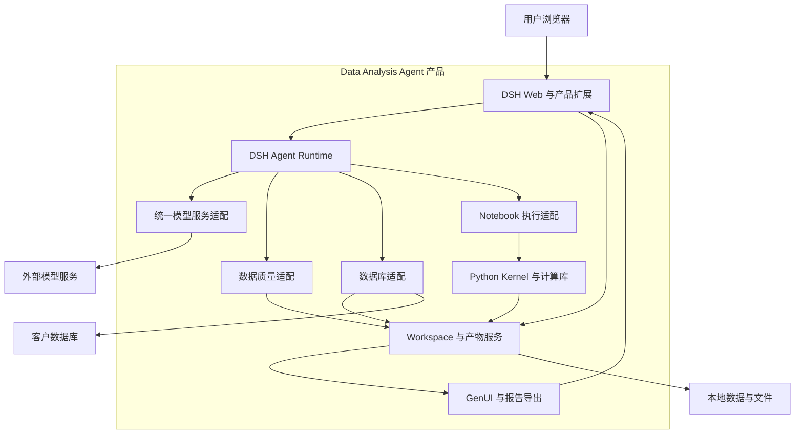
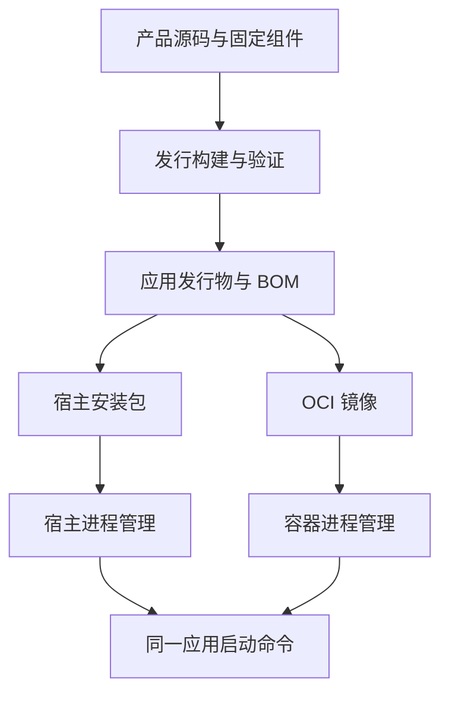
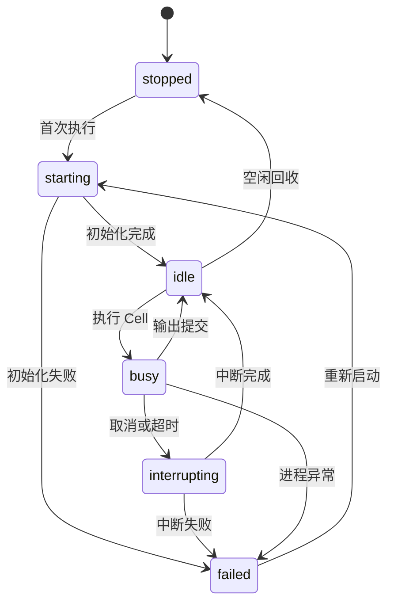
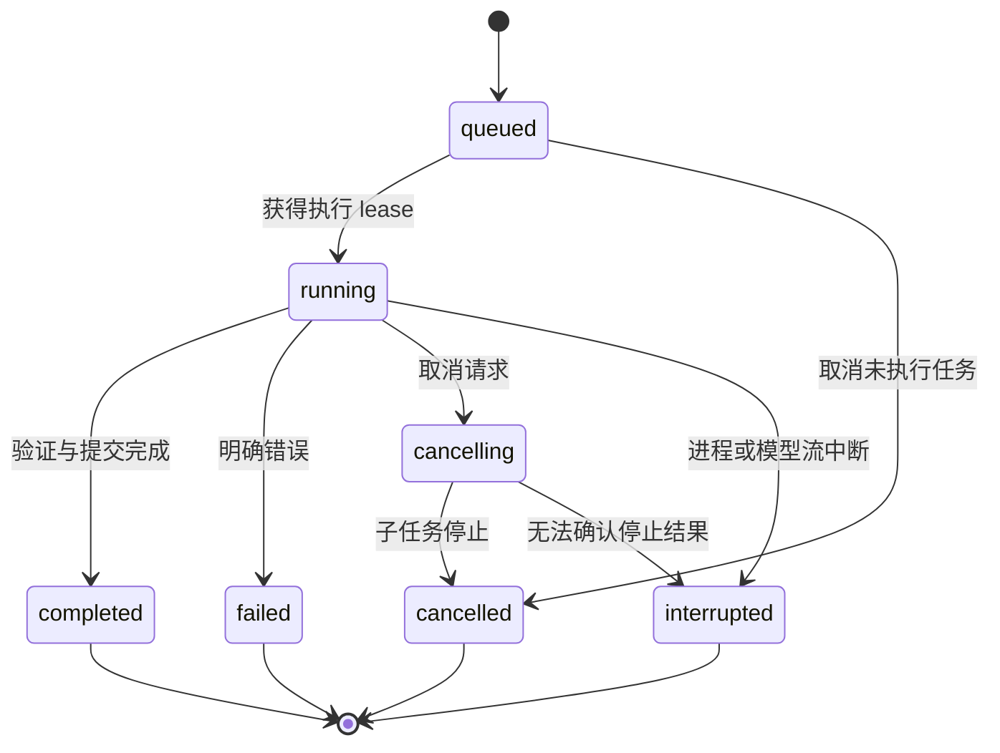

# Data Analysis Agent 需求与详细设计 v0.1

版本为 v0.1，设计基线日期为 2026 年 10 月 8 日，面向首版开发和客户离线交付。

Data Analysis Agent 以自然语言驱动数据获取、质量检查、统计分析、机器学习和可视化，并将执行代码、数据版本和结果保存为可检查的分析产物。首版采用 DeepSeek Harness（以下简称 DSH）、dsh-notebook、dsh-data-quality、dsh-data-agent、dsh-genui 与预装 Python 数据科学环境，优先复用现成插件，补齐产品配置、数据引用、产物管理和发行验证。

产品只通过配置的模型服务接口消费模型能力，可以直接在受支持的宿主操作系统上安装运行。模型权重和推理引擎位于产品边界之外；容器化属于交付层。开发应先在宿主机完成分析闭环，再将相同应用发行物封装成当前交付所需的容器镜像。

本文中的接口、对象、配置和 API 是拟实现的产品契约，除明确标注的上游接口外，不代表第三方插件已经提供这些能力。组件版本冻结和四个插件共同运行的验证是第一个开发里程碑；通过该里程碑后，v0.1 可作为实现基线。

## 1 文档约定

### 规范用语

“必须”表示首版实现或发行验收的约束；“应”表示默认实现方式，变更时须更新相应设计决策；“可”表示可选扩展。P0 表示首版交付必需能力，P1 表示首版后的扩展，P2 表示远期方向。

本文区分三类内容：已经确定的产品边界、本文确定的首版实现方案、需要在真实组件上完成的兼容性验证。待验证事项不影响创建代码仓库和实现产品领域对象，但不能被填写为已经通过的版本矩阵。

### 术语

| 术语 | 含义 |
| --- | --- |
| Workspace | 一项分析工作的持久目录和资产集合，包含输入数据、Notebook、结果、报告和元数据 |
| Session | DSH 对话会话，首版绑定一个主 Notebook 和按需启动的 Python Kernel |
| AnalysisRun | 一次用户分析请求或手工执行请求，关联模型调用、工具调用、执行记录和产物 |
| DatasetVersion | 不可变的数据版本；清洗、筛选、SQL 提取均产生新版本 |
| DataRef | 产品内的数据引用，指向有版本、有来源的数据或指标文件 |
| Kernel | 持久化 ipykernel 进程，保存当前会话的 Python 内存对象 |
| Artifact | 已登记的分析产物，例如图表、报告、结果表和机器学习模型文件 |
| ModelProfile | 模型服务 URL、协议、模型名、凭据引用和能力声明的配置集合 |
| BOM | 产品发行物的组件、版本、哈希、运行环境和许可证清单 |
| Air gap | 客户环境与互联网隔离；可访问客户允许的内网数据库和模型服务 |

## 2 产品目标与首版范围

### 目标用户与任务

主要用户是需要对本地文件或业务数据库进行分析的业务分析人员、数据分析人员和数据科学开发者。业务人员通过中文对话提出问题并检查结论；技术人员能够查看和修改 SQL、Python Cell、统计方法与模型参数。管理员负责模型服务、数据源和发行配置。

首版以单机、可信使用者为运行基线。一个安装实例可保存多个 Workspace 和 Session，并对并发计算进行排队；首版不承诺不同不可信用户之间的操作系统级隔离。企业多用户接入需要另行实现身份鉴别、权限和执行隔离，不能仅将监听地址改成局域网地址就视为完成。

### 产品目标

用户应能将“检查这份数据并分析影响因素”这样的需求变成一条可检查的执行链路。Agent 负责选择方法、编写代码、解释结果和调整分析；数据引擎负责实际计算。关键结论必须能够追溯到确定的数据版本、代码和计算结果。

产品还必须能在客户安装阶段没有互联网连接的情况下完成安装、启动和分析。运行时需要的插件、Python 包、前端资源、字体和数据库客户端应进入已经验证的发行物；模型服务由客户提供地址和访问条件。

### 范围划分

| 能力 | 首版范围 | 后续范围 |
| --- | --- | --- |
| 数据输入 | CSV、TSV、XLSX、JSONL、Parquet，以及 SQLite、PostgreSQL、MySQL 查询 | 更多数据库、对象存储、流式数据 |
| 数据质量 | 字段概览、缺失、重复、类型异常、声明式清洗与规则校验 | 特定行业规则、复杂跨表质量检查 |
| 统计分析 | 描述统计、分组比较、相关分析、常用假设检验、回归分析 | 更广泛的时间序列、因果推断和专业统计模块 |
| 机器学习 | 表格分类、回归、聚类、基础模型比较和解释 | AutoML、大规模并行搜索、深度学习训练 |
| 可视化 | 常用图表、Notebook 内嵌图、GenUI 结果面板、离线 HTML 报告 | 更复杂的看板编辑、协作发布 |
| 工作记录 | 保存对话、Notebook、数据版本、执行记录和产物 | 可审计的完整科学工作流与组织级治理 |
| 模型调用 | OpenAI Compatible Chat Completions、流式输出、工具调用 | 其他协议适配器、多模型策略 |
| 运行环境 | Linux x86_64、CPU 数据分析、宿主机直接运行 | 更多 OS 与架构、可选数据计算加速 |
| 交付 | 同一应用发行物的宿主安装包和 OCI 镜像；当前客户采用容器 | RPM、DEB、Kubernetes 部署包 |

模型权重管理、LLM 推理引擎、张量并行、模型下载、推理资源调度、GPU/NPU 模型服务生命周期均不属于产品功能。首版也不加入独立的 AgentOS、自进化运行时、第二个 Notebook 引擎或面向全局机器学习模型的生产 Serving 平台。

### 首版成功标准

首版成功不是单独启动几个插件，而是从文件导入或 SQL 提取开始，完成数据质量检查、持久 Notebook 分析、结果核对、图表展示和报告导出。应用重启后能够恢复文件与历史，且清楚告知用户 Kernel 内存已丢失。相同闭环必须在宿主部署和容器交付中成立。

## 3 架构原则

### 模型服务外置

产品必须仅通过模型服务协议调用配置的 Endpoint。业务模块依赖产品模型配置和调用契约，不依据模型名称判断推理引擎、硬件或能力。所有插件中的 LLM 调用必须使用当前 Session 的统一模型服务配置，不能私自请求第二个云端模型或下载本地模型。

Endpoint 可以位于本机、内网服务器、客户模型网关或外部 API。在联网部署中允许管理员配置外部 API；在客户离线交付环境中使用可达的内网 Endpoint。切换模型服务不得要求重建产品发行物。

### 部署形态无关

产品代码依赖文件路径、进程、网络地址与运行环境能力，不依赖 Docker、Compose、Kubernetes、Volume 或容器管理 API。宿主部署与容器部署均调用同一条应用启动命令，具有相同的分析、保存、停止和恢复语义。

交付层可以提供进程隔离、资源限制和网络规则；这些能力不能被伪装成产品天然具有的安全或调度能力。产品需要隔离扩展时，应定义可替换的执行环境接口，再由宿主或容器部署分别实现。

### 优先复用插件

DSH 提供 Agent 会话、模型调用、工具执行及 Web 基础，dsh-notebook 提供主分析 Runtime，其他三个插件分别承担质量检查、数据库和生成式展示。产品定制代码应集中在配置转换、跨插件数据引用、执行关联、产物登记和离线发行验证上。

只有发现明确缺口时才增加薄适配器或少量上游补丁。每个补丁必须记录所针对的版本、原因、接口影响和回归用例，避免以“集成”为名重新实现 Agent Loop、Notebook 编辑器、SQL 客户端和图表引擎。

### 数据计算与模型解释分离

数值、统计量、训练指标和图表坐标来自代码执行结果。模型负责解释这些结果，不直接生成未经计算的最终数值。样本估计、全部数据统计、查询截断、算法近似必须在结果中显式区分。

### 数据与产物使用稳定引用

模块间传递 DataRef 和 ArtifactRef，不在工具结果、事件流和模型上下文中传输完整大表。原始数据版本不可覆盖，派生版本保留父版本和操作记录。路径由 Workspace 服务解析，业务代码不拼接用户提供的绝对路径。

### Kernel 持久与持久存储分离

Cell 之间的变量持续存在属于当前 Kernel 生命周期；Notebook、数据和产物的保存属于文件持久化。保存 ipynb 不代表保存 Python 内存。恢复分析需要重新运行所需代码，并记录新的 Kernel epoch 和执行记录。

### 发行版固定依赖

经过验证的生产发行版必须使用固定的 DSH、插件、Node、Python、系统库和前端资源版本。禁止在客户启动过程中调用 npm、pip、conda、git 或浏览器 CDN 下载依赖。组件集合冻结来自产品发行规则，与是否使用容器无关。

## 4 功能需求

### 首版功能需求表

| 编号 | 需求 | 关键实现约束 | 验收结果 |
| --- | --- | --- | --- |
| FR01 | 创建和打开 Workspace | 根目录可配置，使用产品 ID 解析路径 | 工作文件可保存、重开和列出 |
| FR02 | 新建与恢复 Session | 关联 DSH 会话、Notebook 和模型配置快照 | 历史与 Notebook 对齐，无跨会话内存串用 |
| FR03 | 导入文件并预览 | 保留原文件；识别格式、编码和工作表 | 字段、行数或行数状态、预览和来源可见 |
| FR04 | 执行 SQL 数据获取 | 首版只读；查询超时、数量与字节限制 | 查询结果成为可追溯的数据版本 |
| FR05 | 数据 Profiling | 结果包含完整或采样范围 | 缺失、重复和类型问题可检查 |
| FR06 | 数据清洗 | 规则有顺序，生成新版本，不覆盖输入 | 可查看修改前后差异和质量结果 |
| FR07 | 规则校验 | 校验失败与工具异常分开 | 失败规则有实际值和有限证据样本 |
| FR08 | 持久化 Notebook | Agent 和用户共用一个执行队列 | Cell 可查看、编辑、执行、保存和重新加载 |
| FR09 | 统计分析 | 记录方法、样本量、假设和数值结果 | 结论关联计算证据，无法满足假设时给出说明 |
| FR10 | 表格机器学习 | 固定 split 与随机种子，预处理只 fit 训练数据 | 指标、参数、数据版本和解释产物可追溯 |
| FR11 | 图表与 GenUI 面板 | 图表数据来自计算结果，动作有类型和范围 | 图表展示成功；交互执行有记录 |
| FR12 | 分析报告导出 | HTML 全部资源离线可用 | 无互联网情况下打开报告、图表和明细 |
| FR13 | 产物浏览和下载 | 产物包含哈希、来源与状态 | 用户能找回 ipynb、结果表、图和报告 |
| FR14 | 模型服务配置与测试 | URL、模型名、凭据引用和协议独立配置 | 测试输出基础调用、流式和工具能力的状态 |
| FR15 | 取消分析与 Cell 执行 | 区分 Agent 取消、Kernel 中断与强制重启 | 取消状态正确，无重复执行和旧输出错挂 |
| FR16 | 服务重启恢复 | 不自动重放有副作用代码 | 文件恢复，运行中请求标为 interrupted |
| FR17 | 错误与日志 | 关联 Run、Session、Cell；敏感信息过滤 | 用户可定位数据、模型、SQL、Kernel 错误 |
| FR18 | 宿主机启动 | 同一 CLI 管理启动、诊断和关闭 | 无容器工具仍可完成全部核心功能 |
| FR19 | 离线安装和启动 | 所需依赖已进入发行物 | 客户不执行任何依赖下载 |
| FR20 | 容器交付 | 镜像包装已生成的应用发行物 | 与宿主方式使用相同 BOM 和功能用例 |

### 非功能需求与容量基线

下列数字是首版开发和压测的目标配置，不是已经测得的产品性能。正式上限由同一 BOM、样例数据和测试机器上的报告确定。

| 项目 | 首版目标 |
| --- | --- |
| 测试平台 | Linux x86_64，8 个逻辑 CPU，32 GiB 内存，100 GiB 可用磁盘 |
| 文件导入 | 单文件默认上限 512 MiB；流式落盘，禁止先读入 Node 全部内存 |
| 交互预览 | 默认 100 行；分页最大 500 行；字段值按长度截断 |
| Node 质量计算 | 仅接收受控小表；默认产品路由上限 50 MiB、100000 行 |
| 活跃 Kernel | 默认最多 2 个，其余 Session 排队；可配置 |
| Kernel 执行 | 单 Kernel 串行；默认 Cell 超时 600 秒，可按任务调整 |
| 资源治理 | 记录 Kernel 内存；软阈值限制新任务，硬限制需要 OS 执行后端 |
| Web 响应 | 本地元数据查询 P95 小于 300 ms；不包含 LLM、SQL和计算耗时 |
| 恢复目标 | 文件已提交且未损坏时，可恢复元数据、Notebook 和产物关联 |
| 网络 | 生产运行零互联网依赖；仅访问已配置的数据源与模型服务 |

数据文件大小不等于 DataFrame 内存大小。超过内存预算的任务使用 DuckDB、Polars 或分批计算，不能简单提高上传上限。首版资源阈值和 admission control 是应用级管理，不承诺仅靠 Python 代码实现严格的内存隔离。

## 5 用户交互与分析流程

### Web 工作台

首版复用 DSH Web UI。主区域保持对话，Notebook 通过现有插件入口打开，数据库工作台复用 dsh-data-agent，质量报告和分析结果通过工具结果或 GenUI 展示。产品增加模型设置、Workspace 数据与产物入口，并使用现有扩展槽位接入；不先新建完整独立前端。

用户可从结果追溯到生成它的 SQL 或 Cell。Notebook 手工修改与 Agent 修改必须通过同一 Cell revision 和执行队列。可视化面板负责展示及提交明确动作，不能隐式执行一段由模型输出的任意 JavaScript。

### 文件分析

用户创建 Workspace、上传文件并提出分析目标。应用保存原文件并登记版本，Agent 首先读取数据结构和受限预览，再完成 Profiling。需要清洗时，Agent解释清洗规则、生成派生数据并展示影响范围，随后在 Notebook 中计算统计量或训练模型。

分析过程中，用户能看到当前阶段、运行中的 Cell 和错误。结束时给出结论、数据质量限制、图表及产物下载入口。每个关键数值关联结构化结果中的指标位置；无法验证的数值不能显示为“已验证”。

### 数据库分析

用户配置只读数据源并查看库表结构。Agent 生成 SQL，执行得到完整或明确截断的查询结果，再将结果物化为本地数据版本。Python 分析对该版本运行。进一步追问如果需要重新查询数据库，必须生成新数据版本，不能静默改变原报告的数据依据。

### 中断与恢复

用户点击停止时，应用先取消当前 Run 的模型流和未执行工具，再按 Kernel 状态发起中断。已完成的产物保留，部分结果标记 incomplete。应用重启后恢复历史与文件，显示“计算内核已重新启动，需要运行依赖 Cell”；不会仅凭旧 Cell 输出宣称当前变量已经存在。

## 6 总体架构

### 产品运行结构



产品内的“适配”是对现有插件的集成边界，不意味着引入新的远程微服务。第一版采用一个 Node 应用进程，按需启动由 Notebook 插件管理的 Python sidecar 与 Kernel 子进程；本地 SQLite 保存产品索引，文件系统保存数据和产物。

### 构建和交付结构



产品运行结构只定义应用能力与外部依赖。构建、包装、离线介质、Compose 和 systemd 放在单独的代码目录和文档章节，不能成为分析模块的依赖。

### 组件职责与语言

| 组件 | 实现语言 | 所有权与职责 | 主要依赖 |
| --- | --- | --- | --- |
| 应用入口与配置 | TypeScript | CLI、路径解析、配置校验、启动与关闭 | DSH 启动适配、运行环境探测 |
| 产品集成插件 | TypeScript | 注册产品服务、工具、Web 入口与统一分析预设 | DSH Cordis 插件机制 |
| Workspace 服务 | TypeScript | 数据版本、元数据、文件提交与产物索引 | SQLite、文件存储 |
| Session 与 Run 服务 | TypeScript | 会话映射、Run 状态、事件与执行关联 | DSH Session 与工具生命周期 |
| 模型配置与调用适配 | TypeScript | 产品配置映射、能力检测、统一凭据入口 | DSH 原生模型 Provider |
| 数据质量适配 | TypeScript | 路由至 dsh-data-quality 或 Python 质量计算 | DataRef、受限文件快照 |
| 数据库适配 | TypeScript | 复用连接与 SQL 工具，物化查询结果 | dsh-data-agent、固定客户端依赖 |
| Notebook 适配 | TypeScript 与现有 sidecar | 映射 Notebook、Cell、Kernel 与执行事件 | dsh-notebook |
| 数据科学辅助包 | Python | 格式转换、受控快照、指标写入和基础校验 | pandas、Polars、DuckDB、科学计算库 |
| 分析方法技能 | 文本与少量 Python 示例 | 统计与 ML 方法选择、验证、解释约束 | DSH Skill 或预设的本地机制 |
| 结果展示与导出 | TypeScript 和浏览器代码 | 图表规范、产物登记、离线报告 | dsh-genui、已打包可视化资源 |
| 发行与包装 | 构建脚本 | 依赖锁定、发行组装、Host 与 OCI 包装 | BOM、目标平台工具链 |

### 依赖方向

领域对象和服务端口定义在 products contracts/core 中，不导入 DSH、React、Python transport 或容器库。DSH 适配层依赖这些端口，将上游调用转换成产品对象。组合根负责注册和注入；不以全局可变对象连接所有模块。

“可替换 Runtime”在首版是保持端口清晰，不是额外实现第二个 Agent Runtime。业务代码不复制 DSH 的 Turn Loop；未来替换 DSH 时需要重做对应适配器，而领域数据、配置和产物协议可继续使用。

## 7 第三方组件接入设计

### 上游能力与产品适配边界

DSH 官方 README 明确采用插件架构，并提示仍处于 developer preview、存在兼容性破坏。因此产品版本与 DSH 版本独立，不能用一组 latest 依赖作为发行基线。[R1]

| 组件 | 接入依据 | 首版使用方式 | 需要补齐或验证的内容 |
| --- | --- | --- | --- |
| DSH | 官方仓库与构建入口 | Agent Runtime、Web、Session、工具与模型 Provider | 固定版本的扩展点、事件、监听配置和启动入口 |
| dsh-notebook | 已选定主 Notebook 组件，候选包名 @beihaizb/dsh-notebook | 复用持久 Kernel、Cell UI 与 ipynb | 当前包源码、Python路径、Session绑定、执行队列和停止行为 |
| dsh-data-quality | 官方仓库公开 data_profile、data_clean、data_verify 等工具 | 受控小表质量计算 | 产品 DataRef 到工作目录文件的映射；大表与格式路由 |
| dsh-data-agent | 官方仓库公开 SQL 工作台和数据预设 | 复用连接、目录、SQL、数据库工作台 | 只读验证、查询结果导出、模型配置及外部客户端打包 |
| dsh-genui | 官方仓库公开 dsh-ui 声明式渲染与两种宿主通道 | 复用图表、表格和结果面板 | 实测激活、交互回传、离线资源与数字来源绑定 |

dsh-data-quality 当前公开实现以 TypeScript 在进程内计算，输入包括 CSV、TSV、JSON 和 JSONL，有文件大小及行数上限；它不能直接接收 Python Kernel 中的 DataFrame，也不负责 SQL、机器学习或 Parquet。[R2] 因此跨模块交换使用文件快照，格式和范围由适配器确定。

dsh-data-agent 官方说明包含数据库连接、SQL 工作台、业务元数据及离线 HTML 报告，并支持数据模式预设。[R3] 首版复用这些能力，不把“上游支持某数据库”直接转换成“本产品已完成该数据库离线验收”。

dsh-genui 官方说明存在 registry 和 DOM 两种渲染通道，依赖宿主客户端模块正确激活。[R4] 产品必须测试实际对话中的渲染与交互；只加载到 client bundle 不算功能验收通过。

GenUI npm包必须使用omdsh-dev项目对应的@changfenhuang/dsh-genui。无scope的同名dsh-genui属于另一实现，不得因名字相似安装到本产品中。[R4]

### 统一分析预设

产品只向普通用户暴露一个“数据分析”预设，包含 Notebook、数据库、质量和结果展示所需工具。产品预设由集成插件定义，组合所有必需工具的作用域和方法说明，防止切换数据库预设后 Notebook 工具不可用。

对于支持 installPreset 配置的 dsh-data-agent 版本，可将其自身预设安装关闭，复用工具和工作台，由产品注册统一预设。[R3] 其他插件的开关与工具标识以固定版本真实源码为准，不能照搬不兼容版本的 Cordis 配置。

预设提示词规定先了解数据、使用已配置模型、以执行结果解释结论、保留原数据、记录数据范围和方法限制。提示词不承担只读、路径限制、配额或发行版本固定等强制控制，这些由服务端和发行代码实施。

### 产品定制最小集合

首版新增一个产品集成插件，以及一个小型 Python 辅助包。集成插件注册配置、DataRef、产物和执行关联服务，添加必要的 Web 入口及少量统一工具。Python 包提供可导入的 analyst_runtime 辅助函数，不启动第二套 Kernel，不承载另一套 Agent Loop。

现有工具可以直接使用时，产品仅在共同调用边界增加登记与事件转换。确实需要新工具时，以版本化产品命名空间注册。不得同时开放作用重复、权限不同的两个“执行 SQL”或“执行 Cell”入口，让 Agent 随机绕过受控路径。

### 兼容性验证与版本冻结

启动阶段必须建立以下契约检查。任何缺口应通过适配器或受控补丁修复，并记录到 compatibility.json；禁止跳过失败项后宣称插件已经组合成功。

| 契约 | 验证方法 | 通过条件 |
| --- | --- | --- |
| 安装与注册 | 安装固定组件，启动产品 Profile | 无未解析依赖；必需工具和 Web 扩展存在 |
| Notebook 映射 | 两个 Session 分别执行变量赋值 | Notebook、工作目录和 Kernel 不串用 |
| Cell 生命周期 | 执行、手工修改、Agent修改、中断、重启 | revision 和输出归属正确；所有入口共用队列 |
| 质量计算 | Profile、清洗、验证一个带错误的小表 | 结果正确，报告可读，原文件未被覆盖 |
| SQL 物化 | 对 SQLite、PostgreSQL、MySQL 执行查询 | 返回完整性信息和数据版本；写语句被限制 |
| 模型汇聚 | 对 Endpoint 记录请求 | 全部 LLM 请求使用产品当前配置 |
| GenUI | 真实回复产生图表，点击一个动作 | 渲染激活且回传到正确 Session |
| 离线静态资源 | 浏览器与应用阻断互联网 | UI、Notebook、图表和报告仍可用 |
| 本地启动 | 使用产品 CLI 直接启动 | 不要求容器管理工具和运行时安装 |

本次设计没有取得 dsh-notebook 当前源文件的完整内容，也未执行四插件联合运行测试。其具体工具名、sidecar transport 与配置键必须由 M0 从实际安装包提取后冻结。DSH 与其他插件已读取的公开文档同样不能替代联合运行验收。

## 8 领域模型与数据所有权

### 核心实体

| 对象 | 关键字段 | 所有者与生命周期 |
| --- | --- | --- |
| Workspace | id、name、root、created_at、state | 产品创建；删除前必须明确处理关联文件 |
| SessionBinding | id、dsh_session_id、workspace_id、notebook_id、model_profile_id | 产品保存映射；对话内容以 DSH 保存内容为准 |
| AnalysisRun | id、session_id、trigger、status、config_revision、started_at、ended_at | 产品记录一次分析或手工执行；终态不可回退 |
| Dataset | id、workspace_id、name、source_kind | 用户可理解的数据资产；包含一个或多个版本 |
| DatasetVersion | id、dataset_id、parents、data_ref、operation、scope、schema | 文件提交成功后不可变；派生操作创建新版本 |
| NotebookRef | id、session_id、relative_path、revision | 插件负责内容保存；产品负责映射和索引 |
| KernelLease | session_id、kernel_id、epoch、status、last_used_at | 运行时对象；进程重启后旧 Lease 失效 |
| ExecutionRecord | id、run_id、cell_id、source_revision、source_hash、kernel_epoch、status | 产品关联插件执行；记录源码快照和输出引用 |
| MetricEvidence | id、run_id、data_ref、locator、value_type、unit、scope、verification | 绑定一个结构化计算结果及其校验状态 |
| Artifact | id、run_id、kind、relative_path、sha256、inputs、producer、state | 产品登记已经落盘的文件 |
| ModelProfile | id、revision、protocol、base_url、model、credential_ref、capabilities | 管理员维护；Run使用不可变快照 |
| DataSourceBinding | id、driver、endpoint、credential_ref、readonly | 产品与插件连接标识映射；凭据由凭据服务持有 |

所有持久 ID 使用 UUID，事件顺序使用单独的递增序号，不能用文件名或显示名充当主键。时间存储为 UTC RFC3339，界面按用户配置时区展示。数据中的日期解析时区作为 DatasetVersion 的导入配置保存，不能由宿主当前时区隐式决定。

DatasetVersion 的不可变承诺是产品 API 与运行规范的承诺。拥有任意 Python 文件访问能力的可信使用者仍可能绕过 API 修改磁盘文件，因此使用前校验文件哈希；哈希变化时标记 corrupted 并阻止继续引用旧版本。更严格的不可变存储需要后续执行隔离或只读挂载能力。

### DataRef 契约

DataRef 是小型描述对象。它能定位一个可重读的数据版本，并表达数据范围、格式、完整性和类型信息。服务端保存实际相对路径，客户端和 Agent 主要使用 ref_id。调用者不得通过构造一个 ref_id 获取其他 Workspace 的数据。

```typescript
type DataCompleteness = 'complete' | 'sampled' | 'truncated' | 'unknown';

interface DataRef {
  ref_id: string;
  workspace_id: string;
  dataset_version_id?: string;
  kind: 'table' | 'metrics' | 'figure_data';
  format: 'csv' | 'tsv' | 'json' | 'jsonl' | 'parquet';
  sha256: string;
  size_bytes: number;
  row_count: number | null;
  row_count_status: 'exact' | 'estimated' | 'unknown';
  schema_ref: string;
  completeness: DataCompleteness;
  scope: {
    source_ref?: string;
    filter_description?: string;
    sample_method?: string;
    sample_seed?: number;
    sampled_rows?: number;
    query_result_complete?: boolean;
  };
}
```

“完整”表示当前明确的数据获取范围已经全部物化，不意味着数据库的全部记录都在文件中。含 WHERE 或聚合的查询，其 DataRef scope 必须记录查询范围。未知行数使用 null，不用 0。采样结果必须保留母数据引用、方法和数量。

### 产品内部服务端口

以下是新定义的产品端口，适配器的具体上游调用由 M0 验证后实现。领域代码不直接访问插件内部对象。

```typescript
interface WorkspacePort {
  importFile(input: ImportRequest): Promise<DataRef>;
  resolveData(refId: string, scope: AccessScope): Promise<ResolvedData>;
  registerArtifact(input: ArtifactCommit): Promise<ArtifactRef>;
}

interface NotebookPort {
  ensureSession(binding: SessionBinding): Promise<NotebookRef>;
  getCells(notebookId: string): Promise<CellSnapshot[]>;
  updateCell(input: CellUpdate): Promise<CellSnapshot>;
  execute(input: CellExecution): AsyncIterable<ExecutionEvent>;
  interrupt(executionId: string): Promise<InterruptResult>;
  restart(sessionId: string): Promise<KernelLease>;
  save(notebookId: string): Promise<NotebookRef>;
}

interface QualityPort {
  profile(input: ProfileRequest): Promise<ProfileResult>;
  clean(input: CleanRequest): Promise<CleanResult>;
  verify(input: VerifyRequest): Promise<VerifyResult>;
}

interface DatabasePort {
  testConnection(sourceId: string): Promise<ConnectionTest>;
  describe(sourceId: string): Promise<CatalogSnapshot>;
  query(input: QueryRequest): Promise<QueryResultRef>;
}
```

接口中的 DataRef、Cell revision、超时、取消信号和 scope 必须是实际执行参数，不能只写入日志。只有在端口职责发生变化时才新增接口；跨插件共享服务通过 DSH 注入或组合根显式传入，不建立额外的全局 Service Locator。

## 9 存储与一致性设计

### 存储分工

SQLite 保存产品元数据、映射、Run 状态、执行索引和产物清单；DSH 保存自己的对话和插件状态；Notebook 插件保存 ipynb；数据、图片、模型文件和报告保存在 Workspace。产品索引引用 DSH ID 与报告键，不复制维护另一份对话主记录。

| 路径角色 | 示例相对位置 | 内容 |
| --- | --- | --- |
| product state | state/product.sqlite | 产品元数据与迁移版本 |
| DSH state | state/dsh | DSH配置、会话及插件存储；由启动适配器映射 |
| input data | workspaces/{workspace_id}/datasets/{dataset_id}/original | 原始上传文件与来源说明 |
| dataset versions | workspaces/{workspace_id}/datasets/{dataset_id}/versions/{version_id} | 数据文件、schema和导入或派生manifest |
| Notebook | workspaces/{workspace_id}/notebooks/{session_id} | 主Notebook及其保存版本 |
| Run results | workspaces/{workspace_id}/runs/{run_id} | 指标JSON、SQL、参数、验证记录和执行输出 |
| artifacts | workspaces/{workspace_id}/artifacts/{artifact_id} | 最终图、报告、模型文件和manifest |
| temporary data | cache/{workspace_id}/{run_id} | 未提交快照、中间文件与转换临时目录 |
| secret store | state/credentials | 受权限保护的凭据或加密凭据文件 |

实际 data_dir、state_dir、cache_dir 均由配置决定。不同物理位置之间通过产品 ID 关联。没有任何目录必须来自 Docker Volume，也不要求放在 /opt 下。

data_dir是工作数据的父目录，每个Workspace根目录为data_dir/workspaces/{workspace_id}；state_dir保存产品SQLite及dsh子目录，cache_dir保存可清理临时文件。表中的相对路径用于说明分工，实际实现必须以对应配置根目录解析。

### 元数据表设计

最小表集合为 workspaces、session_bindings、analysis_runs、datasets、dataset_versions、notebooks、executions、artifacts、metric_evidence、model_profiles、datasource_bindings、run_events 与 schema_migrations。关联字段建立外键和索引；多态 lineage 放入受 JSON Schema 校验的 manifest，常用查询字段单列保存。

SQLite 使用 foreign_keys、WAL 和 busy_timeout；写操作在主进程通过 Repository 层完成。多个 Kernel 不直接写 SQLite，而是写临时文件，由产品服务提交并登记。Workspace 不应放在未经过 WAL 行为验证的共享网络文件系统上；首版数据库使用本地文件系统。

关键状态更新使用 compare-and-set，例如仅允许 running 的 Run 进入 completed 或 cancelling。执行 lease token 与 Kernel epoch 一起检查，旧进程迟到的消息不能改变当前状态。

### 文件与元数据提交

新数据或产物首先写入目标文件系统的临时位置，关闭文件后计算哈希和验证大小，使用同一文件系统的原子 rename 发布，再在 SQLite 事务中登记为 ready。数据库写入失败时留下可识别的未登记文件，恢复任务根据 commit manifest 对其进行补登记或清理。

文件系统与 SQLite 之间没有跨系统原子事务。因此实现必须使用 pending、ready、incomplete、corrupted 状态与启动 reconciliation，不能假设一次普通文件写入加一次 INSERT 永远同时成功。

Notebook 手工保存仍由插件负责。产品应捕获成功保存事件或调用受支持保存接口后再更新 revision；不抢夺同一个 ipynb 文件的写锁。插件缺少可靠保存钩子时，增加受控补丁，而不是让产品定时覆盖文件。

### 保留与清理

输入与已登记产物默认不自动清理。临时文件在对应 Run 终止并经过 24 小时后可清理；Kernel 空闲回收只释放内存，不删除 Workspace。首版 Workspace 删除是显式动作，先停其 Run 和 Kernel，再清理索引与文件。关联文件的哈希和manifest保留到删除完成，便于处理部分失败。

## 10 模型服务设计

### 统一配置与协议边界

首版支持的协议值为 openai-chat，即 Chat Completions 及其工具调用、流式协议。Responses 是单独的协议，不能将“OpenAI Compatible”解释成任意 Chat 与 Responses 接口都可以互换。以后增加协议时实现独立适配器，业务配置仍保持 URL、model 与凭据引用的基本形态。

```yaml
id: default-model
revision: 1
protocol: openai-chat
base_url: http://model-gateway.internal:8000/v1
model: analyst-model
credential_ref: env:MODEL_API_KEY
request:
  connect_timeout_ms: 10000
  response_timeout_ms: 120000
  stream_idle_timeout_ms: 60000
  temperature: 0.2
  max_output_tokens: 8192
capabilities:
  streaming: required
  tool_calling: required
  vision: disabled
limits:
  context_window_tokens: 65536
  max_output_tokens: 8192
extra_body: {}
```

context_window_tokens 是管理员声明的上限，不从模型名推断，也不宣称 GET /models 可以可靠返回该信息。协议适配器将产品 max_output_tokens 映射到具体 Endpoint 支持的请求字段。extra_body 不能覆盖 model、messages、tools、stream 或认证字段，参数冲突在配置保存时拒绝。

### 与 DSH 模型 Provider 的关系

产品模型层首先是稳定配置和能力边界，不在 DSH 之外运行第二套 LLM 客户端链路。配置适配器将 ModelProfile 转换为固定 DSH 版本所需的模型 Provider 配置，DSH 继续执行 Agent 的实际模型请求。需要 LLM 的产品插件也调用当前 Session 的同一 DSH 模型服务。

产品可定义 ModelInvocationPort 对模型能力进行归一化，但它的 DSH 实现委托原生 Completion/Provider 调用层，而不是再次启动 DSH Agent Turn。这样避免“DSH Agent → 产品模型层 → DSH Agent”的递归，也避免维护两套凭据、重试和模型连接代码。

首版不增加内部 HTTP 模型代理。只有出现明确的网关、审计或跨协议需求时，才评估单独代理；统一入口不等于必须在本机再部署一个服务。

### 配置生效与模型能力测试

ModelProfile 每次保存产生新 revision。新 Run 使用当前配置快照，进行中的 Run 继续使用其启动时版本；改 URL 或模型名不能让一个流式回复中途切到另一个服务。敏感凭据不保存到 Run快照，仅保存引用标识和不含秘密的配置哈希。

测试连接分层检查网络、认证、最小 Chat、流式及工具调用。GET /models 是可选检查；模型列表未提供时，直接对配置 model 进行最小生成测试。工具测试让模型调用一个无副作用的固定示例工具，只验证格式与基本选择能力，不能证明实际分析质量。

| 检测状态 | 含义 | 产品行为 |
| --- | --- | --- |
| passed | 本次探测成功 | 记录时间、配置revision与测试结果 |
| failed | 本次探测明确失败 | 显示可定位原因，禁止required能力缺失时启动Agent |
| unknown | 未测试或无法确认 | 不假装支持；required能力在使用前必须通过检查 |
| disabled | 管理员关闭该能力 | 不发起相应请求 |

### 超时与重试

连接失败和短暂服务不可用可以进行至多 2 次有界重试，并尊重 Endpoint 的 Retry-After；上下文超限和请求字段错误不能盲目重试。开始返回流式内容后若断线，本轮标记 interrupted，并保留已收到内容。

工具调用片段按 call_id 和 index 聚合，只有参数 JSON 完整、Schema 校验通过、模型结束相应调用后才交给工具。模型流重试不能重复执行 SQL、Cell或产物提交。已经执行过工具的 Agent Turn 需要结合执行账本判断恢复路径，不能从头自动重放。

### 数据发送边界

Agent 可以将字段信息、质量摘要和受限样本发送到配置的模型 Endpoint；“本地分析”不意味着模型服务从未收到数据。首版默认每次数据摘要最多 20 行、每个字段最多 200 字符，并设置上下文大小预算。敏感列由 Workspace规则屏蔽；需要扩大样本范围时按规则进行显式操作。

凭据不进入提示词、tool结果、浏览器快照或日志。数据库账号密码由执行服务解析 credential_ref，不能让 Agent 自己读取配置文件来获取。离线部署的 Endpoint 必须位于客户允许网络中。

## 11 数据获取与跨插件协议

### 导入过程

导入服务流式保存上传内容，校验允许格式和文件签名，计算 sha256，登记原始文件。Python辅助包读取需要科学库解析的格式，生成结构化 schema、有限预览和标准数据版本。文件格式猜测与真实解析不一致时返回 DATA_FORMAT_ERROR，不强行按扩展名解释。

CSV 和 TSV 保存编码、分隔符、表头、缺失值规则和日期时区。XLSX 中多个工作表分别登记，可由用户指定分析对象；公式值缺少已缓存结果时标记 unavailable，不宣称产品会自动计算 Excel 公式。JSONL 必须符合可表格化约束，嵌套字段的展开规则写入 manifest。

原文件始终保留。Parquet 是默认内部表格存储格式，CSV用于兼容插件和导出。没有必要为了一个小 CSV 强制转换全套格式；是否生成标准化文件由后续操作所需能力决定。

### 小表质量计算与大表路由

在产品设定的行数与字节限制内，CSV/TSV/平面JSON/JSONL通过 dsh-data-quality 计算。Parquet/XLSX首先按 schema 转换为受控兼容快照，完整性和数值精度符合要求时再交给插件。

超过限制的数据通过 Python/Polars/DuckDB执行同一产品 QualityPort 所需的基础质量指标；这个分支只补齐必需指标，不复制上游全部规则引擎。首版支持行数、缺失、重复键、基本类型和约束校验，其余复杂规则明确返回 unsupported。

如果数据规模只能支持抽样，则生成 sampled DataRef，并说明哪些指标由全部数据计算、哪些来自样本。不能将一次抽样Profiling生成的清洗计划当成对全部数据已经实施的清洗结果。

### Python 与 TypeScript 的数据交换

Python对象通过 notebook内的 analyst_runtime 写入版本化文件，TypeScript通过 DataRef解析文件。工具返回DataRef、schema、摘要和产物引用；Node与Kernel之间不序列化整个DataFrame，不在模型上下文中传递Parquet二进制。

需要交给质量插件时，Python将表格导出为独立快照，保存字段类型、NULL表示、时区和转换策略。计算结束后将报告登记为产物，并关联输入快照与原始数据版本。插件内部reportKey由适配器保存，用户主要查看产品artifact_id。

### 数值与类型一致性

JavaScript Number不能精确表达所有64位整数或高精度小数。主数据保留Parquet类型；超过安全整数范围的ID列按字符串送到TypeScript，Decimal金额可采用带scale的整数或明确的小数字符串。需要精确金额计算时走Python Decimal或数据库Decimal路径，不使用浮点插件结果充当精确财务结果。

NaN、Infinity和缺失值使用明确的null及类型信息表示，不能输出非标准JSON。百分比指标同时保存数值比例、展示单位和分母；timestamp区分带时区值与纯日期。转换导致精度损失时拒绝exact模式，或标记approximate并给出误差约定。

### 清洗与验证

清洗请求引用固定的DatasetVersion，并保存有顺序的规则列表。预览返回行数变化、字段变化与影响样本；执行创建新版本，重新运行关键约束，保存原版和新版引用。禁止清洗工具在原路径直接写入。

质量验证不通过是业务结果，例如 passed=false 与失败规则证据；文件损坏、字段不存在或规则格式错误才是工具错误。相同数据、规则和参考时间应产生相同结果。freshness之类依赖时间的规则必须显式保存as_of时间。

### SQL 查询与数据版本

dsh-data-agent的连接及工作台由适配层复用。首版允许的数据库必须逐一验收：SQLite只读打开，PostgreSQL使用只读事务与受限账号，MySQL使用受限账号及适用的只读事务。SQL AST检查用于阻止写语句和多语句，数据库权限仍是最终边界。

查询服务配置statement timeout、max_rows、max_bytes和取消能力。若结果只取了前N行，应返回truncated=true，并拒绝把这些行的SUM或AVG解释成全部查询范围的指标。完整总量应通过数据库聚合查询获得，或在已完整物化的数据上计算。

一次查询结果保存SQL文本、参数的脱敏记录、连接ID、数据库类型、获取时间、可获得的事务/快照信息以及DataRef。外部数据库的查询重放不保证相同数据；报告复现优先使用已物化结果。

如果插件只将少量结果写入对话而没有可复用导出接口，需要通过其执行服务或受控补丁取得实际查询结果。不得让模型把预览行重新拼成CSV并宣称那是数据库完整结果。上游依赖的数据库CLI与动态库纳入BOM，不能在客户环境临时安装。

## 12 Notebook 与执行生命周期

### 绑定关系

首版一个Session绑定一个主Notebook和至多一个活跃Kernel；Kernel按需启动，多个Session可以属于同一Workspace但不共享Python内存。大数据共享通过不可变DataRef文件实现，不能把“同目录”解释成“同一份DataFrame对象”。

Kernel及其Python sidecar由dsh-notebook的现有生命周期实现管理，产品保存映射与执行索引。Python解释器由产品发行物提供并显式配置；禁止依赖用户shell偶然找到的python或自动创建conda环境。具体配置方式由M0确认。

### 统一队列与 Cell revision

Agent执行、用户点击Run Cell、Run All和其他程序入口必须共用Notebook插件的唯一执行调度边界。优先复用已有队列并增加观察和revision检查；如果插件缺少入口钩子，补丁必须覆盖全部入口。仅在产品新工具外加一把锁，而原UI仍能直接运行，不算完成串行化。

每次Cell更新带expected_revision。不匹配时返回CELL_REVISION_CONFLICT，Agent重新读取Cell后决定下一步。每次执行提交源码快照、source_hash、kernel_epoch和lease token；执行期间用户修改源码，原输出仍关联执行时的源码，而不是修改后的文字。

单Session同一时刻只接受一个Agent分析Run。新的分析消息可以进入待办队列，首版API默认以SESSION_BUSY返回并提供当前run_id。手工Cell执行只有在Agent未持有该Session写入lease时才能开始。浏览器刷新不释放执行lease。

### 执行完成与输出事件

Notebook适配器必须正确处理stdout、stderr、execute_result、display_data、update_display_data、clear_output、error和status。Jupyter消息使用parent_header关联请求，并区分shell回复和IOPub状态。[R5]

产品执行完成条件为对应execute_reply已收到、相应请求的idle状态已处理，输出已按插件协议完成收集并提交。不能仅收到第一张图或一个reply就将Run标为完成。IOPub迟到消息和后台线程输出可能存在，未能归属当前请求的输出不绑定到新Cell。[R5]

Agent默认使用allow_stdin=false，避免input()将后台任务永久挂起。文本和MIME输出设置大小上限；超出上限保存截断说明，必要的完整结果应写入文件产物。

### 内核状态



Kernel启动或重启生成新的epoch。进程ID只用于运行时诊断，不能单独用PID识别旧进程。连接文件和内核端口仅在本地使用，不作为浏览器可直接访问的公共服务。

### 取消与超时语义

用户取消Run时，先停止模型生成和未执行工具，再中断运行中的Kernel执行。默认给中断10秒宽限，随后按配置停止Kernel进程树并增加epoch。被强制终止的执行状态为interrupted，相关未提交产物标为incomplete。

即使中断成功，已执行语句可能改变变量或写入部分文件。Kernel设置state_dirty=true，下一次Agent操作先检查对象和所需依赖；不能向用户承诺“取消已回滚全部状态”。需要完全恢复干净环境时重新启动Kernel并重新运行必要Cell。

### 保存与重放

Notebook保存源代码、输出与有限元数据，不保存所有Python对象。进程重启后保留旧输出用于查看，同时将executed_in_current_epoch=false。新的执行记录注明当前epoch，并重新验证引用的数据文件哈希。

首版不自动重放全部Notebook。用户或Agent提交明确的重新执行请求时，运行必要的依赖Cell，重新创建指标和产物；旧结果保留版本。重放涉及外部数据库、文件修改或联网请求时，需要按当前规则重新判断执行条件。

### 内部通信选择

首版复用dsh-notebook已有的Node与Python sidecar通信及Jupyter Kernel通信，不额外规定一套新HTTP计算服务或自建TS到Python ZMQ协议。Jupyter本身使用ZeroMQ是Kernel协议实现细节，不等于产品必须开放ZMQ接口。[R5]

NotebookPort是稳定业务边界，transport可在未来替换。内部事件需携带request_id、execution_id、session_id和epoch，避免消息错归属。新增辅助操作优先通过当前Kernel导入Python包执行，保持“一个Session一个主Runtime”。

## 13 分析编排与执行账本

### Agent 分析步骤

默认分析方法为了解目标和数据范围、检查数据质量、选择分析方法、执行计算、检查结果并输出报告。它是Agent的方法约束，不要求所有问题都执行同一固定工作流。简单计数不必训练模型，机器学习任务则必须记录split和评估信息。

编排代码不取代DSH Agent Loop。产品在用户请求入口创建AnalysisRun，在工具共同调用边界记录ExecutionRecord和DataRef/Artifact关联，并在DSH完成或异常事件中提交Run终态。

### Run 状态与阶段



阶段字段phase独立于status，可为inspect、quality、compute、validate、present。状态管理不假设每次Run都经历所有阶段。Agent正常返回但必要产物验证失败时，该Run不能自动标为completed；记录failed或具体错误，保留已生成内容。

### 幂等与执行关联

创建Run和提交Cell执行支持Idempotency-Key。同一scope、key和payload_hash再次请求返回已有操作；同key不同payload返回409。执行登记必须先于副作用开始，但数据库记录与Kernel执行无法形成原子事务。

如果进程在执行已开始但未记录完成时崩溃，状态为interrupted/unknown，不自动重复执行。恢复页面显示已经开始过的执行及现存产物，让新的Run显式检查后继续。幂等账本用于减少重复提交，不能宣称在跨进程崩溃情况下实现绝对exactly-once。

### 关键结论验证

计算Cell输出metrics.json，使用稳定指标名和scope。MetricEvidence保存DataRef、JSON定位、类型、单位和验证状态。关键聚合值可以从已物化数据重新计算进行核对；其他模型指标用固定的实际/预测结果和参数重新验证。

dsh-data-quality的verifyCitations可以辅助核对快照中的数值或字符串，但不能验证一个自然语言因果解释或整份报告的方法正确性。[R2] 产品将“值与结果一致”“数据范围明确”和“方法限制已说明”分别记录，不用一个verified标签替代全部分析可靠性。

## 14 统计分析与机器学习设计

### 方法能力组织

首版方法以本地分析技能和Notebook可执行代码提供。统计与ML算法使用成熟Python库，产品主要补充方法选择提示、结构化结果格式和验收脚本。算法计算不通过另一个外部LLM评分器完成。

| 能力 | 默认库 | 必须记录的内容 |
| --- | --- | --- |
| 描述统计与分组 | pandas、Polars、DuckDB | 数据版本、过滤条件、分组键、缺失处理和样本量 |
| 假设检验与区间 | SciPy、statsmodels | 零假设、检验类型、适用假设、统计量、p值、区间和方法 |
| 回归分析 | statsmodels、scikit-learn | 变量选择、参数、诊断、评估范围和预测区间适用条件 |
| 分类与回归训练 | scikit-learn、XGBoost、LightGBM、CatBoost | 目标、split、预处理、参数、种子、基线和指标 |
| 聚类与降维 | scikit-learn | 特征缩放、距离/算法参数、簇解释和评估限制 |
| 模型解释 | SHAP及模型原生解释 | 背景数据、解释方法、样本范围、特征顺序和计算预算 |
| 图表 | Plotly、Matplotlib、GenUI | 数据引用、轴单位、聚合范围和图表配置 |

### 统计结果格式

stats.json应包含analysis_type、input_refs、population_scope、n_total、n_used、missing_policy、method、parameters、statistics、uncertainty、assumptions_checked与limitations。方法不适用时返回unsupported或解释需要的条件，不自动挑选一个能生成显著结果的方法。

相关分析不表达因果；存在重复测量、时间相关、分层抽样或多重比较时应明确限制或采用相应方法。p值不能解释为“原假设为真的概率”，显著性与业务影响分别说明。结论使用实际效应量、区间和样本范围。

### 机器学习过程

训练输入固定DatasetVersion、target、feature列表和任务类型。先排除明显的目标泄漏字段和标识列，再按任务选择随机、分层、分组或时间切分。保存train/validation/test的样本标识或可复现索引、切分种子和数据哈希。

缺失填补、缩放、编码、特征选择等步骤在训练集上fit，再应用到验证和测试数据；尽量使用Pipeline或等效显式结构，避免在全数据上预处理后再切分。[R6] 参数搜索只使用训练与验证范围，测试集在最终比较时使用一次，不用来反复挑模型。

首版分类至少报告与问题相适应的precision、recall、F1、混淆矩阵；ROC AUC和PR AUC仅在可用概率、类别和指标条件满足时计算。回归报告MAE、RMSE、R²并与简单基线比较。聚类指标说明定义和解释边界，不能把silhouette直接当成业务分群有效性的证明。

### 模型文件与训练产物

训练产物包含模型文件、参数、特征schema、切分manifest、metrics、解释图和environment lock摘要。模型是数据分析任务产生的ML模型产物，区别于产品所消费的外部LLM权重；首版允许保存表格模型，但不包含LLM模型管理。

首版仅重新加载本产品生成且哈希验证通过的可信模型产物。joblib或pickle可能执行对象恢复代码，因此用户上传的未知模型文件不自动反序列化。训练结果schema应能独立查看，不依赖先加载模型文件。

### 可复现性范围

保存数据快照、代码、依赖版本、随机种子和训练参数，目标是使同一发行版能够重建主要结果。并行算法、底层BLAS、不同CPU架构可能造成小幅差异，应在fixture中规定数值容差。首版不承诺跨所有硬件逐位一致。

长训练使用Kernel现有进度输出和取消机制，设置线程数量与搜索预算，避免两个Kernel各自占满全部CPU。运行依赖缺失时返回ENVIRONMENT_INCOMPLETE并给出缺少的包，禁止在Cell中自动pip install或下载示例数据。

## 15 可视化与报告设计

### 展示路径

Notebook图表优先由Plotly或Matplotlib生成，保留原始图与对应数据；对话中的结构化图表和表格使用dsh-genui。两条展示路径引用同一指标或图表数据文件，不能由模型分别编造两组数据。

GenUI的chart规范由适配器根据已经执行的结果生成或校验。模型可以选择布局、标题和图类型，但指标值、单位、类别与数据范围必须能从DataRef解析得到。无法绑定结果的装饰性示例数据不得出现在正式分析报告中。

### 交互动作

首版允许的动作包括查看明细、切换本地筛选、请求重新绘图和提交新的分析请求。每个动作携带session_id、run_id、component_id和typed payload，并经过服务端Schema及权限检查。旧Run面板的动作不能静默写入当前另一Session。

本地筛选可以直接操作面板已持有的有限数据，需注明筛选范围；请求数据库重查或Kernel重算时创建新Run与执行记录。界面不能用“切换一个选项”掩盖一次昂贵或可能改变状态的计算。

### Artifact manifest

```json
{
  "schema_version": 1,
  "artifact_id": "example-artifact-id",
  "workspace_id": "example-workspace-id",
  "run_id": "example-run-id",
  "kind": "html-report",
  "file": "report.html",
  "sha256": "GENERATED_FROM_ACTUAL_FILE",
  "state": "ready",
  "inputs": ["example-data-ref"],
  "metric_evidence_ids": ["example-metric-evidence-id"],
  "producer": {
    "type": "report-export",
    "execution_id": "example-execution-id",
    "product_version": "1.0.0"
  }
}
```

上例是字段示意，ID与哈希由实现生成，不能复制示例值作为真实manifest。ArtifactKind首版包括notebook、table、metrics、figure、html-report、quality-report和ml-model。只有实际文件完成提交且哈希存在时才标记ready。

### 离线报告

报告包含结论、数据来源与获取时间、完整或采样范围、方法、关键指标、图表、限制和产物来源。可以复用data-agent已生成的报告，但必须补齐产品manifest，并验证资源和内容来源。Python图表也通过统一报告导出接口登记。

首版HTML报告使用发行物内的可信模板和图表库，资源内联或附带在完整导出目录中，不引用CDN、远程字体、在线地图和远程JavaScript。默认输出单文件HTML；太大的数据采用完整报告目录，并将数据范围明确展示，不内嵌整份原始数据。

应用内展示报告时使用隔离的iframe和限制性CSP。模型生成的HTML文本、字段名和标签必须转义，禁止注入脚本。可执行JavaScript只能来自已固定和验证的图表资源；导出HTML的本地交互不拥有产品凭据，也不能直接调用应用写接口。

## 16 Web 设置与操作设计

### 模型设置

管理员可配置协议、Base URL、模型名、API Key、上下文限制和超时，并点击测试连接。保存后显示配置revision和测试状态。界面只展示用户理解和操作所需的信息，不暴露DSH内部服务名、Cordis注入结构和推理引擎配置。

API Key字段只显示已配置状态，客户端不能读取旧密钥。新值只提交到凭据服务；清空密钥需要明确删除操作，空字符串与“保持原密钥”采用不同请求语义。

### 数据与 Notebook

数据入口显示文件名、格式、版本、来源、行数状态和质量摘要。Notebook显示Cell源码、执行状态、输出与是否在当前Kernel epoch执行。用户可以从结论打开对应Cell或SQL，通过修改Cell发起新的执行。

手工与Agent竞争修改时显示当前revision冲突，不悄悄覆盖。Kernel丢失时保留Notebook内容，提供重新启动与重新执行入口，不自动隐藏旧结果。

### 运行与产物

运行状态使用“等待资源、检查数据、执行计算、验证结果、生成报告”等用户可理解的描述。错误展示操作对象和下一步，例如模型服务不可达、字段不存在、结果超过限制或Kernel被重启；内部stack trace放在诊断日志中。

产物列表按Run关联，用户可以下载报告、数据表、Notebook和图表。incomplete与corrupted文件不得和完成产物一起显示为正常结果。

## 17 应用接口设计

### CLI

产品命令是新增入口，由薄启动适配器调用已经安装并构建完成的DSH，不使用npx下载执行。首版命令如下。

| 命令 | 职责 | 退出语义 |
| --- | --- | --- |
| data-analyst serve --config PATH | 校验配置，启动DSH Profile和产品插件 | 正常停止为0，配置或启动失败为非0 |
| data-analyst doctor --config PATH | 检查Python、必需包、可写目录与组件锁 | 不修改生产环境，不自动安装依赖 |
| data-analyst test-model --config PATH | 测试配置的外部模型服务 | 能力状态结构化输出 |
| data-analyst version --json | 输出产品版本、平台与BOM摘要 | 不调用外部网络 |
| data-analyst export --run ID --output PATH | 导出已完成Run的报告和manifest | 不自动重新计算Run |

server.host与server.port通过产品配置映射到当前DSH启动/监听方式。不能把上游支持过的某个CLI flag当作永久产品参数；产品CLI的配置转换与上游版本一起测试。

### REST API

下表为拟实现的产品API，以/api/v1命名。它们可通过DSH Host Web扩展注册并适配现有服务；不代表上游当前存在这些路由。必需的稳定路由首先覆盖配置、Workspace、DataRef、Run和产物，Notebook编辑器既有接口保持由插件适配，避免先包装其全部内部API。

| 方法与路径 | 功能 | 关键约束 |
| --- | --- | --- |
| GET /healthz | 本地进程是否存活 | 不探测外部模型和数据库 |
| GET /readyz | 产品本地必需能力是否初始化 | 必需插件、存储、发行环境可用；外部服务状态单独报告 |
| GET /api/v1/capabilities | 发行版与功能能力状态 | 不返回秘密或私有路径 |
| POST /api/v1/workspaces | 创建Workspace | name校验，不接受任意根路径 |
| GET /api/v1/workspaces/{id} | 读取Workspace元数据 | 按当前访问scope校验 |
| POST /api/v1/workspaces/{id}/datasets/import | 上传并导入文件 | multipart流式写入；返回异步operation_id |
| GET /api/v1/operations/{id} | 导入或其他异步操作状态 | 状态和结果DataRef分开 |
| GET /api/v1/data/{ref_id}/preview | 查看有限预览 | 分页、长度与敏感列限制 |
| POST /api/v1/workspaces/{id}/sessions | 创建Session与Notebook绑定 | 创建结果必须完成DSH映射 |
| POST /api/v1/sessions/{id}/runs | 提交分析请求 | 绑定DataRef、模型revision和Idempotency-Key |
| GET /api/v1/runs/{id} | 查询Run、执行及产物状态 | 终态与部分结果都可查看 |
| POST /api/v1/runs/{id}/cancel | 请求取消 | 先返回cancelling，再查询确认终态 |
| GET /api/v1/runs/{id}/events | SSE运行事件 | 可重连；不重新执行工具 |
| POST /api/v1/sessions/{id}/kernel/restart | 重启当前Kernel | 增加epoch；不能静默重放Notebook |
| GET /api/v1/artifacts/{id} | 查看产物manifest | 状态、哈希、来源可见 |
| GET /api/v1/artifacts/{id}/download | 下载已登记文件 | 不接受用户拼接路径 |
| PUT /api/v1/model-profiles/{id} | 保存模型配置 | expected_revision控制冲突 |
| POST /api/v1/model-profiles/{id}/test | 测试模型服务 | 当前管理员scope，结果关联revision |

导入阶段需要解析XLSX/Parquet时，可以使用固定Python解释器运行一个受控、短生命周期的import命令。它属于格式处理工具，受相同资源预算管理，不是第二套持久分析Runtime；已有Session下的计算仍优先在其Notebook Kernel执行。

### 分析请求和事件

```json
{
  "message": "分析这份数据中的缺失和重复，比较各渠道转化率并导出报告",
  "data_refs": ["example-data-ref"],
  "model_profile_id": "default-model",
  "expected_model_revision": 1,
  "options": {"output": "html-report"}
}
```

请求返回202、run_id和status。DataRef不存在、属于其他Workspace或哈希失效时，在启动Agent之前拒绝。没有必需模型能力时返回明确错误，不创建一个表面running但永远无法工作的新Run。

事件包含event_id、seq、workspace_id、session_id、run_id、type、timestamp与payload。主要type为run.status、tool.started、tool.completed、cell.output、artifact.ready和run.completed。模型原生逐token输出继续使用DSH已有传输，产品事件流承担执行与资产关联，不再复制第二条完整token流。

SSE在同一Run下采用单调序号，持久保存状态和产物事件；高频stdout事件有界缓冲。客户端携带Last-Event-ID重连时，若所需输出已超出保留范围，返回恢复标记与当前状态，不承诺无限重放每一个输出字节。

### 统一错误结构

```json
{
  "error": {
    "code": "CELL_REVISION_CONFLICT",
    "message": "该单元格已更新，请读取最新内容后重试",
    "request_id": "example-request-id",
    "run_id": "example-run-id",
    "retryable": false,
    "details": {"expected_revision": 4, "current_revision": 5}
  }
}
```

配置格式错误返回400，未登录401，无权访问403，资源不存在404，状态或revision冲突409，业务语义无效422，容量排队限制429，外部服务失败502/503，执行超时504。文件上限返回413。错误details不得包含密钥、数据库密码、完整模型请求和未过滤的数据样本。

### Agent 工具接入

已有Notebook、SQL、质量和GenUI工具继续复用，在调用服务边界登记Run与执行结果。产品只新增必要的数据及结果工具，例如analyst.inspect_data、analyst.list_artifacts、analyst.commit_results和analyst.verify_metrics。这里的名称是产品拟实现标识，具体DSH注册规则由M0确认。

新增工具返回摘要、引用和下一步可用能力。commit_results只能登记已经存在并通过校验的文件；Agent不能仅声明“report.html已生成”就创建ready产物。所有原生工具的可见入口也必须经过相同控制，不能保留一个绕过revision、范围或资源管理的旧入口。

## 18 配置与凭据管理

### 产品配置示例

以下YAML展示产品自身的配置，不包含容器字段。相对路径以配置文件所在目录解析；发行启动脚本负责提供默认配置位置和发行根目录。

示例假定配置文件与runtime目录处于同一层级。实际Host和OCI包装必须生成与安装位置一致的路径；运行环境目录不能根据进程当前工作目录猜测。

```yaml
schema_version: 1
server:
  host: 127.0.0.1
  port: 3080
  public_base_url: http://127.0.0.1:3080
auth:
  mode: local-token
paths:
  data_dir: ./data
  state_dir: ./state
  cache_dir: ./cache
  runtime_dir: ./runtime
runtime:
  profile: data-analysis
  python: auto
  compute_device: cpu
  max_active_kernels: 2
  idle_kernel_timeout_seconds: 1800
  cell_timeout_seconds: 600
  interrupt_grace_seconds: 10
  max_cell_output_mib: 8
data:
  max_upload_mib: 512
  preview_rows: 100
  model_sample_rows: 20
  model_sample_cell_chars: 200
  quality_ts_max_mib: 50
  quality_ts_max_rows: 100000
database:
  readonly: true
  statement_timeout_seconds: 60
  max_result_rows: 1000000
  max_result_mib: 256
model:
  profile_id: default-model
  protocol: openai-chat
  base_url: http://model-gateway.internal:8000/v1
  model: analyst-model
  credential_ref: env:MODEL_API_KEY
  connect_timeout_ms: 10000
  response_timeout_ms: 120000
  stream_idle_timeout_ms: 60000
  temperature: 0.2
  max_output_tokens: 8192
  context_window_tokens: 65536
  capabilities:
    streaming: required
    tool_calling: required
    vision: disabled
  extra_body: {}
network:
  mode: intranet
  allowed_model_endpoints:
    - http://model-gateway.internal:8000/v1
  internet_runtime_downloads: false
logging:
  level: info
  structured: true
  store_data_samples: false
```

runtime.python=auto仅解析为已安装发行物内的解释器，不搜索远程环境，也不下载安装Python。开发模式可以指定解释器绝对路径；生产发行物的doctor必须确认解释器、辅助包和依赖来自该BOM。

本节model块是第10节ModelProfile的启动配置投影，配置加载器生成对应对象；运行中Web更新仍通过revision机制生效。schema_version用于产品配置迁移，与DSH配置结构及产品版本分别管理。

### 加载顺序与冲突

非秘密设置按默认配置、配置文件、明确环境变量、CLI显式参数的顺序覆盖。支持的环境变量有固定映射，例如DATA_ANALYST_SERVER_HOST、DATA_ANALYST_SERVER_PORT和DATA_ANALYST_DATA_DIR。禁止把整个任意环境自动拼入DSH配置。

静态运行设置与持久ModelProfile分开管理。YAML中的model块仅在对应profile不存在时导入为初始配置；之后SQLite中的版本化ModelProfile为权威来源，Web设置或模型Profile API更新它。重启不以旧YAML覆盖新配置。环境变量通过credential_ref动态提供秘密；需要改变已存在的Endpoint时使用设置页或API，doctor输出不含秘密的最终生效配置。

未知字段、非法范围和数据目录不可写在启动时返回CONFIG_INVALID。只有模型或数据库暂不可达时，允许本地UI启动以便修改设置。产品版本升级涉及配置迁移时先备份旧文件并记录迁移版本。

### 凭据

credential_ref支持env:NAME、file:PATH及产品凭据服务标识。没有认证的模型Endpoint使用显式none，不强制要求提供假API Key。凭据只在实际请求或连接建立时由服务端解析，空值和缺失值按Endpoint要求判断。

Web保存凭据使用已有DSH凭据服务作为优先实现；产品只保存映射。若固定版本无法满足持久密钥保护，则实现本地加密凭据存储，主密钥来自受权限保护文件或环境。主密钥不与加密凭据一起导出到分析Workspace。

首版本地登录令牌通过受控启动流程生成，只保存哈希验证材料；浏览器换取HttpOnly、SameSite会话凭据。产品API、DSH原生会话接口及插件路由必须由同一认证边界保护，否则只保护/api/v1不能算完成。

## 19 运行边界与可靠性

### 可信代码执行边界

Notebook执行的Python具有进程账号对应的文件和网络权限，首版以可信使用者为前提。产品路径校验限制通过产品接口的文件访问，不能防止任意Python代码直接访问账号可读目录。系统服务使用独立低权限账号，应用文件与可写工作数据分开。

首版不开放通用Agent shell或任意进程安装工具；数据库客户端由受控执行服务以参数数组启动，不把用户SQL拼入shell命令。Notebook可能仍具备Python自身的subprocess能力，这一事实应与后续多用户执行隔离设计一致。

Web输入、SQL预览和Notebook输出均视为不可信展示内容；校验HTML、SVG、URL与文件路径。使用Origin/CSRF检查、限制CORS与连接来源，避免将本地监听误认为天然没有浏览器攻击面。

### 网络规则的职责

产品Model/Database客户端仅访问管理员配置的Endpoint，默认不跟随到未授权主机的重定向。server-side URL测试受Endpoint允许列表和地址规则约束；ModelService需要本机或内网地址时由管理员明确配置。

网络配置不是任意Python代码的强隔离。客户Air gap与操作系统/网络层规则提供互联网不可达保证；宿主部署可通过防火墙落实，容器交付可通过宿主规则和相应网络限制落实。禁止把Docker internal network当成统一方案，因为它可能同时阻断客户内网模型与数据库。

### 启动与健康状态

启动顺序为校验配置和发行清单、检查目录与元数据版本、执行恢复对账、启动DSH及产品插件、验证必需工具与Web能力、开放业务接口。Kernel懒启动，不在服务启动时为每个历史Session创建进程。

/healthz仅反映进程可响应；/readyz验证本地必需能力，包含Python环境静态检查但不要求已有活跃Kernel。模型与数据源属于外部依赖，在设置页和相应Run启动前检查。外部模型短暂离线不应触发整个应用重启风暴。

### 优雅关闭

SIGTERM/SIGINT后停止接受新Run，取消模型流和排队执行，给活跃Cell有界中断时间，保存Notebook并提交能确认完成的产物，更新未完成Run状态，再关闭Kernel与sidecar进程树、DSH服务和存储。默认应用关闭预算30秒，部署进程管理器至少提供45秒。

进程被强杀后，下次启动将旧running/cancelling标为interrupted，清理过期lease并对pending文件进行对账。不能仅看到一个Kernel PID还存在就复用它；未确认所有权的子进程按当前账号和进程token进行受控清理。

### 错误恢复表

| 故障 | 保存行为 | 后续行为 |
| --- | --- | --- |
| 模型服务不可达 | 保留已完成工具与部分回复 | 修复配置后创建新Run；不自动重做已执行工具 |
| Kernel崩溃或OOM | 保留已提交文件；未完成执行标interrupted | 重启Kernel，增加epoch，重新运行必要Cell |
| SQL超时 | 保存SQL和错误；结果文件标incomplete | 调整范围或超时后提交新查询 |
| 磁盘不足 | 不创建ready元数据 | 停止新提交，清理明确临时文件后恢复 |
| 插件缺失或版本不符 | 保留原状态；启动报组件错误 | 使用正确发行版，禁止现场在线安装修复 |
| GenUI渲染失败 | 保留计算结果和图文件 | 返回文字、表格或已生成图片，并记录渲染故障 |
| 文件哈希不一致 | 数据或产物标corrupted | 拒绝使用旧证据，重新导入或从备份恢复 |

降级显示不能隐藏计算失败。GenUI无法展示时可以使用已经验证的数据结果；缺少质量或Notebook必需能力时则阻止对应分析，而非伪造成功内容。

## 20 日志与可观测性

应用日志使用JSON，包含timestamp、level、component、request_id、workspace_id、session_id、run_id、execution_id、duration_ms与error_code。Notebook标准输出和业务指标分别保存，默认日志不记录原始数据行、完整提示词、模型请求头或凭据。

记录活跃Kernel数、排队Run数、执行时间、模型请求错误、SQL超时、文件提交失败、事件重连和产物验证失败。首版提供本地诊断与结构化日志，不要求外部监控服务。

诊断包包含去敏配置、BOM摘要、组件状态、版本与错误索引；可选择包含特定执行源码，但默认不加入输入数据、数据库密码和模型密钥。审计记录只描述产品操作范围，不声称实现了完整组织级合规审计。

## 21 运行环境与应用发行物

### 首版运行环境

首版以Linux x86_64、CPU数据计算为基线。Node选用与冻结DSH兼容的固定版本；当前官方package.json声明Node范围为^22.19.0或>=24.0.0，应据实际版本矩阵选择一个具体patch版本并锁定。[R7] Python首版选择CPython 3.11系列，并在M0验证所选科学库和插件，不提前宣称所有后续Python版本均兼容。

Python环境包含numpy、pandas、polars、pyarrow、duckdb、openpyxl、scipy、statsmodels、scikit-learn、xgboost、lightgbm、catboost、shap、plotly、matplotlib、ipykernel、jupyter_client、nbformat及辅助包。依赖的BLAS/OpenMP/系统动态库、字体和数据库客户端随目标平台发行。

这些是数据分析计算依赖，不包含LLM Serving runtime。首版安装包与镜像均不包含LLM权重、vLLM、SGLang、CUDA推理环境、CANN推理环境及模型下载器。以后数据科学任务需要GPU时，作为独立计算profile增加，不改变外部模型服务边界。

### 应用发行物布局

| 发行路径 | 内容 |
| --- | --- |
| bin/data-analyst | 可直接调用的产品CLI入口 |
| app | 已构建DSH及产品TypeScript代码 |
| plugins | 固定插件与已经构建的host/client模块 |
| runtime/node | 目标平台Node运行时 |
| runtime/python | 可验证的目标平台Python发行环境 |
| python/packages | 科学计算依赖与analyst_runtime |
| web/assets | 已打包静态资源、字体与图表JS |
| config/default.yaml | 产品默认配置 |
| manifests | BOM、文件校验、兼容矩阵与SBOM |
| licenses | 组件许可证和第三方声明 |

直接复制一个开发机venv通常不足以形成可迁移发行物，Python脚本shebang、绝对路径和动态库搜索路径都可能绑定原位置。必须选择可迁移环境打包方案，或将安装前缀固定后进行完整验证。可迁移方案须在两个不同安装路径下运行doctor和分析用例；固定前缀方案须明确安装位置限制并验证升级目录布局。

应用代码与runtime只读，用户数据目录可写。启动程序只创建状态目录，不执行安装步骤。任何必要的首次启动初始化都必须是本地操作，并在断网测试中覆盖。

### BOM 与锁文件

产品保留pnpm-lock.yaml、Python带哈希的锁文件、components.lock.json和目标平台BOM。npm包名、仓库、版本与commit同时记录，避免仓库名称与包名称不同导致装错组件。源码补丁单列记录哈希。

```yaml
schema_version: 1
release: data-analyst-1.0.0
platform: linux-x86_64
application:
  version: 1.0.0
  commit: VERIFIED_SOURCE_COMMIT
components:
  dsh:
    version: VERIFIED_EXACT_VERSION
    source_commit: VERIFIED_COMMIT
  dsh_notebook:
    package: "@beihaizb/dsh-notebook"
    version: VERIFIED_EXACT_VERSION
  dsh_data_quality:
    package: dsh-data-quality
    version: VERIFIED_EXACT_VERSION
  dsh_data_agent:
    package: "@yejiming/dsh-data-agent"
    version: VERIFIED_EXACT_VERSION
  dsh_genui:
    package: "@changfenhuang/dsh-genui"
    version: VERIFIED_EXACT_VERSION
runtime:
  node: VERIFIED_EXACT_VERSION
  python: VERIFIED_EXACT_VERSION
locks:
  javascript: pnpm-lock.yaml
  python: requirements.lock
verification:
  compatibility_report: compatibility.json
  offline_report: offline-verification.json
```

上例是生成结构，VERIFIED字段必须由真实构建替换，发行检查拒绝任何未填写值、宽范围版本和latest标签。候选版本不等于通过联合验证的BOM；产品不能仅依据各插件独立README的兼容范围拼出发布清单。

### 依赖准备与离线构建

联网构建区下载固定源码、npm包、Python wheels、系统包和可视化资源，保存哈希与来源；需要编译的原生模块在目标平台工具链上提前构建。封闭构建区只消费准备好的依赖库，使用禁止互联网访问的构建过程组装发行物。

若采用容器完成构建，network=none只是构建验证的一种实现，不进入产品运行逻辑。宿主构建同样要在受控网络条件下证明不会临时拉取遗漏依赖。基底镜像、编译器及系统动态库也需要提前准备，不能把它们当作天然存在的隐含前提。

核查范围包括插件安装脚本、启动时包解析、动态import、字体、Plotly/SHAP资源、Matplotlib字体缓存、数据库CLI、Notebook内示例数据下载、遥测、检查更新和远程模型调用。关闭下载入口只是配置手段；实际断网运行和请求记录才是验收依据。

## 22 宿主安装与容器交付

### 宿主安装

首版认证目标为Ubuntu 24.04 x86_64。其他Linux发行版作为待测试平台，不因能够启动Node就自动纳入支持范围。宿主安装包包含相同应用发行物、校验清单、配置示例及本地安装脚本；客户只需满足已记录的OS、权限、存储和网络条件。

应用可以解压到用户可读的目录，显式指定可写data/state/cache路径后运行。系统服务安装可以使用/opt/data-analyst放置只读应用、/etc/data-analyst放置配置、/var/lib/data-analyst保存状态和数据；这只是默认包装约定，不是产品硬编码目录。

```bash
./bin/data-analyst doctor --config ./config.yaml
./bin/data-analyst test-model --config ./config.yaml
./bin/data-analyst serve --config ./config.yaml
```

安装脚本不调用apt、yum、npm或pip。发行包自带运行依赖，或在清单中明确客户预置的系统依赖；缺少依赖时安装失败并给出具体检查结果。目标平台的系统库兼容是发行验收项目，不能写成“任意Linux免依赖运行”。

可选systemd模板如下，其执行目标仍是相同产品CLI。

```ini
[Unit]
Description=Data Analysis Agent
After=network.target

[Service]
Type=simple
User=data-analyst
Group=data-analyst
WorkingDirectory=/var/lib/data-analyst
ExecStart=/opt/data-analyst/bin/data-analyst serve --config /etc/data-analyst/config.yaml
Restart=on-failure
TimeoutStopSec=45
KillMode=control-group
NoNewPrivileges=true
EnvironmentFile=-/etc/data-analyst/secrets.env

[Install]
WantedBy=multi-user.target
```

### OCI 镜像

镜像构建输入是已验证的应用发行物，不在镜像启动时安装组件。包装层设置用户、默认路径、监听配置和进程入口；不增加另一份Agent或Notebook运行逻辑。

容器内监听地址可以配置为0.0.0.0以便端口映射，宿主端口默认绑定127.0.0.1。这个差异是同一server.host配置的部署取值差异，不是产品代码检测容器后切换实现。镜像必须正确处理PID 1与子进程回收，可由部署层使用init。

最小Compose模板只定义数据分析产品，不包含模型服务。

```yaml
services:
  data-analyst:
    image: company/data-analyst:1.0.0
    pull_policy: never
    init: true
    restart: unless-stopped
    command:
      - serve
      - --config
      - /etc/data-analyst/config.yaml
    ports:
      - "127.0.0.1:3080:3080"
    environment:
      DATA_ANALYST_SERVER_HOST: "0.0.0.0"
      MODEL_API_KEY: "${MODEL_API_KEY:-}"
    volumes:
      - ./config.yaml:/etc/data-analyst/config.yaml:ro
      - ./data:/var/lib/data-analyst
      - ./cache:/var/cache/data-analyst
    security_opt:
      - no-new-privileges:true
    cap_drop:
      - ALL
    stop_grace_period: 45s
```

模板要求镜像ENTRYPOINT是/opt/data-analyst/bin/data-analyst。包装脚本生成匹配的配置：data_dir为/var/lib/data-analyst，state_dir为/var/lib/data-analyst/state，cache_dir为/var/cache/data-analyst，runtime_dir为/opt/data-analyst/runtime。端口、镜像标签和UID/GID以发行清单为准，安装脚本为挂载目录设置正确权限。

Compose使用pull_policy=never防止现场拉取遗漏镜像，并将版本固定。[R8] 发行包记录已验收的Docker Engine与Compose版本；宿主部署不要求这些工具。客户已有模型在宿主或其他服务器时，通过可达URL配置，不添加Model容器，也不挂载LLM权重。

### 离线交付清单

| 文件或目录 | 作用 |
| --- | --- |
| application/data-analyst-host-1.0.0-linux-x86_64.tar.zst | 同一应用发行物的宿主安装包 |
| images/data-analyst-1.0.0.tar.zst | 当前容器交付所需的产品镜像 |
| deployment/compose.yaml | 容器启动模板 |
| deployment/config.example.yaml | 产品配置示例 |
| deployment/data-analyst.service | 可选宿主服务模板 |
| manifests/versions.lock 与sha256sums.txt | 精确版本与文件校验 |
| manifests/sbom.spdx.json 与compatibility.json | 组件清单与兼容测试报告 |
| licenses | 许可证和第三方声明 |
| scripts/install.sh、verify.sh、start.sh、stop.sh | 本地安装与进程管理封装 |
| scripts/smoke-test.sh | 验证产品核心分析闭环 |

客户介质可以仅包含选定交付profile所需的安装包，但构建源必须是同一应用发行物。发行包没有models目录、model-server镜像和模型下载脚本。模型URL、名称及可选凭据由客户提供。

### 升级与回退

升级先停止新Run并关闭活跃Kernel，再备份产品SQLite、DSH状态、配置和Workspace manifest；使用SQLite备份API或停机一致性备份，不能只在运行时复制主数据库文件而遗漏WAL。

新应用发行物安装到独立版本目录，验证文件和环境后执行必要迁移，并切换启动指向。回退仅在元数据schema兼容时直接切换；不兼容迁移需要恢复对应备份。容器回退标签不会自动回退持久数据schema。

升级不触碰用户输入数据或已完成产物，也不要求更换客户模型服务。DSH上游存储格式变化必须纳入升级测试，不能只验证产品SQLite迁移。

## 23 代码仓库与开发约束

### 仓库组织

采用一个TypeScript monorepo加Python辅助包。各目录的职责如下。

| 目录 | 主要内容 |
| --- | --- |
| apps/cli | data-analyst入口、doctor、启动与关闭 |
| packages/contracts | DTO、Schema、DataRef、ArtifactRef和版本化接口 |
| packages/core | Workspace、Run、存储Repository和领域规则 |
| packages/dsh-integration | 产品Cordis插件、预设、上游版本适配和启动配置 |
| packages/model-service | 模型Profile、凭据引用、能力检测和DSH配置映射 |
| packages/notebook-adapter | NotebookPort实现、Cell revision和执行事件 |
| packages/data-adapters | 数据导入、质量和SQL适配 |
| packages/artifacts | 文件提交、manifest、数字证据与报告导出 |
| packages/web-extension | 设置、数据和产物入口；复用DSH UI |
| python/analyst_runtime | 数据转换、指标输出、基础质量计算与结果校验 |
| skills | 分析方法、统计、ML和报告的本地技能 |
| config | 产品Schema、默认配置和开发配置示例 |
| distributions | 应用发行物组装与BOM生成 |
| packaging/host | 宿主安装脚本和systemd模板 |
| packaging/oci | Dockerfile、Compose与镜像导出 |
| patches | 必需的上游小补丁及原因说明 |
| tests/fixtures | 固定小表、坏格式、SQL及ML样本 |
| tests/contracts | 对固定版本DSH与插件的真实接口检查 |
| tests/e2e | 产品分析、恢复、离线和交付验收 |
| docs | 设计基线、兼容矩阵、ADR、使用和交付说明 |

模块可以先在少数包内实现，待职责稳定后拆分；表中的职责边界应从第一天保持。避免为了目录完整而创建大量仅转发一层的空包，也避免把所有模块写入一个不可测试的巨型产品插件。

### 编译与接口规范

TypeScript启用strict，使用一个统一的运行时Schema库校验API、工具参数与manifest。Schema和TypeScript DTO来自同一源定义，减少两份手写结构不一致。Python辅助包消费相同schema_version，并提供版本不匹配错误。

contracts不能依赖DSH或部署包；上游适配器可以依赖contracts/core。CI通过依赖检查阻止core导入Docker或React。TypeScript示例中的签名需要在contracts中补全类型定义，不应将本文片段直接作为可编译完整实现。

运行时进程启动使用argv数组，不将用户文件名、SQL和代码拼到shell字符串。路径解析、文件提交、状态转换与Cell调度集中在各自服务中，UI和Agent工具调用同一实现。

### 决策记录

首先建立ADR001模型服务外置、ADR002部署无关、ADR003插件优先复用、ADR004主Notebook Runtime、ADR005文件数据引用与不可变版本、ADR006单Kernel串行执行、ADR007生产固定依赖与离线运行、ADR008可信单机执行边界。

每个ADR记录决策、适用范围、实现位置和验证方法。后续变更某条基线时同步更新设计文档、BOM约束和验收，避免只在代码中悄悄引入一个模型下载器或容器管理依赖。

## 24 开发里程碑

### M0 组件验证与版本冻结

首先搭建宿主开发环境，取得DSH和四个插件的实际安装包及源文件，提取包名、版本、Peer依赖、Profile补丁和工具Schema。可优先核验dsh-data-agent当前开发依赖所使用的DSH 0.2.0-rc.2这一候选线，再对Notebook等组件检查是否兼容；该候选不能直接视为产品已测试版本。[R9]

完成第7节联合契约验证，确认Notebook工具覆盖、Python路径、队列与中断钩子，SQL结果物化和GenUI交互。产出components.lock.json、compatibility.json与必要补丁说明。若发现必须大幅重写插件才能接入，先修订具体适配决策，保留模型和部署两条产品边界。

M0退出条件是五个核心组件在同一固定DSH版本下跑通真实最小闭环，且无运行时下载。不能只用各插件分别成功启动的截图替代。

### M1 文件分析闭环

实现产品CLI、最小配置、Workspace、数据版本、Session绑定与Notebook适配。先支持CSV和Parquet，复用质量插件完成小表Profiling，在Notebook计算确定的聚合结果，使用GenUI或已生成图展示，并导出一个完整离线HTML报告。

该阶段产出可在宿主机启动的产品样机。用户能够上传一个固定样例、提出分析请求、打开执行Cell、下载报告，并在重启后找回Notebook与产物。此时再扩充XLSX/JSONL，不先开始镜像优化。

### M2 统计与机器学习

实现本地分析技能、指标文件、MetricEvidence及校验；支持一个统计比较、一个分类任务和一个回归任务。补齐split manifest、泄漏检查、模型文件登记和基础解释图。验证用户手工改Cell后重新执行得到新结果版本。

退出条件是结果能从固定数据和代码重建，关键指标由确定性代码验证，取消与Kernel崩溃不会把部分产物标为ready。

### M3 SQL 与运行治理

接入SQLite、PostgreSQL与MySQL真实测试环境，复用data-agent连接和工作台，补齐只读、超时、查询结果DataRef和截断语义。完成Kernel数量限制、排队、同Session冲突、模型配置revision与日志关联。

退出条件是SQL到Notebook到报告的完整链路可运行，数据范围可解释，用户取消后不会出现旧输出进入新Run，模型或数据库暂时离线时可修复配置后继续使用。

### M4 发行与离线交付

组装目标平台应用发行物，生成BOM、SBOM、许可证与校验文件；验证宿主运行后用相同发行物构建OCI镜像和Compose包。执行互联网隔离下的安装、启动、Notebook、统计、ML、SQL和报告测试，并完成升级与回退。

M4退出条件是客户只执行介质导入、配置和启动，不需要依赖安装。验收记录包含产品版本、平台、外部测试Endpoint、测试数据哈希和全部用例结果。

### 开工时首先创建的内容

第一批提交应包含设计基线、ADR、contracts中的核心Schema、只实现必要命令的CLI、固定组件获取与安装脚本，以及M0契约测试。第二批提交实现Workspace与Session的最小映射，再完成一份数据的端到端分析。

首版不先实现多租户控制、Kubernetes部署、GPU数据Runtime、第二套Agent框架或科学审计平台。未来dsh-science-workbench可在有明确provenance与reproducibility需求时进入额外profile，不作为当前闭环的前置依赖。

## 25 验证与验收设计

### 计算与接口测试

契约测试必须调用真实固定DSH/插件服务；算法结果测试使用小型可人工或独立代码核验的fixture，不只检查对象结构。Agent模型输出不按逐字一致比较，而检查执行路径、输入版本、指标和产物。

| 编号 | 场景 | 关键断言 |
| --- | --- | --- |
| T01 | 两Session分别赋值并读取变量 | 变量及输出互不串用 |
| T02 | 用户与Agent同时提交同Cell操作 | 只有共同队列调度；过期revision被拒绝 |
| T03 | Cell输出图、stdout并延迟结束 | 所有输出正确归属，未到完成条件不提前提交 |
| T04 | 强杀Kernel后恢复 | epoch变化；旧执行interrupted；Notebook仍可打开 |
| T05 | 不同格式导入相同数据 | schema、NULL、日期与数值转换有明确结果 |
| T06 | 高精度小数与超大整数 | 不出现静默精度损失；ID保持原值 |
| T07 | 小表质量清洗 | 原文件哈希不变；新版本和规则记录正确 |
| T08 | 超出TypeScript质量边界 | 走Python/受限样本路径，范围有标记 |
| T09 | SQL LIMIT或max_rows截断 | completeness=truncated；不计算虚假的全量结论 |
| T10 | 数据库写入、多语句与超时 | 被权限及服务限制，记录明确错误 |
| T11 | 模型流断线并重连 | 不重复执行已提交的Cell或SQL |
| T12 | 更新模型配置 | 当前Run保持旧revision，新Run采用新revision |
| T13 | 训练验证数据预处理 | fit仅使用训练范围，测试集不用于选择参数 |
| T14 | 人为更改已登记文件 | 哈希检查失败，旧证据不能继续标verified |
| T15 | 提交文件后数据库故障 | 启动对账能识别未登记文件，无虚假ready记录 |
| T16 | GenUI渲染及动作 | 图数值来自实际结果，交互回传正确Session |
| T17 | 请求超过模型或数据容量 | 明确失败或排队，不无限重试及占满内存 |
| T18 | 服务优雅停止 | Run终态正确，Kernel和sidecar完成回收 |

### 固定数值验收样例

fixture_sales.csv至少包含渠道、访客数和成交数。使用下列确定数据验证聚合、百分比及报告数字，避免只检查“报告里有一个图”。

| 渠道 | 访客数 | 成交数 |
| --- | --- | --- |
| A | 100 | 10 |
| A | 300 | 60 |
| B | 200 | 20 |
| B | 100 | 5 |

预期A渠道转化率为70/400=17.5%，B为25/300≈8.333333%，总体为95/700≈13.571429%。总体转化率必须由总成交数除以总访客数，不能平均各行或各渠道百分比。fixture同时覆盖零分母、NULL和字符串单位的失败或处理分支。

统计fixture包含已知均值和差异的固定数据，独立核对样本量、效应量和检验值。MLfixture固定split与种子，验证数据分离、预测文件和指标重新计算；浮点容差随锁定库与硬件测试记录，不规定一个未测得的模型准确率作为通用标准。

### 离线发行验收

测试环境与互联网物理或网络层隔离，同时保留客户允许的内网模型和数据库。外部模型测试服务是验收基础设施，不作为产品镜像或交付包组成部分。

| 编号 | 验收动作 | 通过标准 |
| --- | --- | --- |
| O01 | 从介质验证并导入安装包或镜像 | 校验成功，无外部下载 |
| O02 | 启动宿主安装和容器交付 | 都调用同一应用发行物入口 |
| O03 | 打开设置、Notebook与数据工作台 | 前端无CDN、字体与远程脚本请求 |
| O04 | Python导入全部必需科学库 | 不自动安装包、下载模型或数据 |
| O05 | 配置内网模型并实际分析 | Chat、流式和工具调用可用 |
| O06 | CSV质量检查与统计 | 结果符合fixture和方法约定 |
| O07 | 表格ML训练和解释图 | 模型、指标、SHAP或替代基础解释产物可生成 |
| O08 | 查询内网PostgreSQL/MySQL | 使用已打包依赖，物化数据正确 |
| O09 | 保存报告并在隔离浏览器打开 | 图表可渲染，资源和数据来源完整 |
| O10 | 重启应用并打开原Workspace | 文件和映射保留，Kernel状态正确提示 |
| O11 | 监测所有进程与浏览器网络行为 | 无互联网访问及npm/pip/git下载行为 |
| O12 | 断开模型或数据库 | 出现正确错误；恢复后可继续分析 |

每次正式release都运行O01至O12。源码扫描通过但真实运行仍尝试联网时，验收失败；依赖已经进入构建缓存但不在实际交付包中时，同样失败。

### 需求追踪

| 需求组 | 主要模块 | 必须通过的验证 |
| --- | --- | --- |
| FR01至FR03 | Workspace、导入、SessionBinding | T01、T05、T14、O10 |
| FR04 | DatabasePort与data-agent适配 | T09、T10、O08 |
| FR05至FR07 | QualityPort和Python基础质量路径 | T06、T07、T08、O06 |
| FR08、FR15、FR16 | NotebookPort、lease、执行与恢复 | T02、T03、T04、T18、O10 |
| FR09、FR10 | 分析技能、metrics、ML产物 | T13、固定数值fixture、O06、O07 |
| FR11至FR13 | GenUI、Artifact与报告 | T14、T15、T16、O09 |
| FR14、FR17 | ModelProfile、错误与日志 | T11、T12、T17、O05、O12 |
| FR18至FR20 | CLI、应用发行物、包装 | O01、O02、O03、O04、O11 |

## 26 设计决策与实施风险

### 首版决策汇总

| 决策 | 首版确定方案 | 变更条件 |
| --- | --- | --- |
| Agent Runtime | 复用固定版本DSH | 必需功能无法通过薄适配实现时重新评估 |
| Notebook | dsh-notebook作为唯一主计算Runtime | M0证实无法满足关键执行契约时修订 |
| 产品与模型 | 配置外部模型API；复用DSH模型调用 | 新协议需求增加适配器，不增加LLM权重 |
| TS与Python | TypeScript产品服务，Python科学计算 | transport变化保持NotebookPort与DataRef |
| 数据交换 | 文件快照、DataRef与受限摘要 | 大规模外部存储需求再扩展StoragePort |
| 持久化 | SQLite索引加本地Workspace文件 | 多机共享状态需求出现后再引入外部数据库 |
| 并发 | 单Kernel串行，默认2个活跃Kernel | 实测资源能力后调整，不改Cell语义 |
| UI | DSH UI加现有插件与小型产品扩展 | 明确的产品交互缺口再扩大定制 |
| 支持平台 | 首版Ubuntu 24.04 x86_64 CPU | 逐平台验收，禁止以猜测扩大支持范围 |
| 交付 | 同一发行物生成Host和OCI包 | 新部署平台只新增包装与执行后端 |

### 需要优先解决的风险

| 风险 | 实施后果 | 对应处理 |
| --- | --- | --- |
| DSH及插件版本变化快 | 工具、预设和Web接口可能不兼容 | M0真实联合测试，精确锁定与小补丁 |
| Notebook执行入口不能统一 | 手工与Agent并发改变状态、输出错归属 | 验证所有入口，必要时补丁队列及revision |
| 插件数据对象不互通 | SQL/质量/Python成为互不关联的功能岛 | DataRef与不可变文件快照 |
| JavaScript与Python数值类型不同 | 金额、大整数或日期结果不一致 | 类型保真与精确计算路由 |
| Python环境或前端资源未完整打包 | 客户断网无法启动或出图 | 可迁移/固定前缀验证与运行网络检查 |
| 误将ipynb保存当作内存保存 | 恢复后变量缺失而界面仍显示旧输出 | epoch与执行状态明确，按需重放 |
| 将单机可信运行直接开放给多人 | 路径与Kernel权限无法构成强隔离 | 保持首版边界，多用户作为独立扩展 |

### 后续扩展

在首版闭环稳定后，可增加更多数据库、领域指标、时间序列方法、共享Workspace权限和后台任务。具备明确审计需求时再考虑science-workbench profile。数据计算GPU扩展、远程Kernel、组织登录与严格执行隔离各自形成独立设计，不需要把模型服务重新纳入产品。

## 27 首版交付完成条件

首版交付必须同时满足：固定组件组合通过M0；文件与SQL分析都能生成可检查的Notebook、指标和报告；取消、崩溃及重启语义正确；产品直接在受支持宿主运行；容器只包装同一发行物；客户安装与运行不下载依赖；模型服务通过URL、模型名和凭据配置，产品没有LLM权重或推理引擎。

正式release随附BOM、兼容矩阵、离线测试记录和已知限制。P1能力可以保留为后续计划，但P0分析闭环、版本冻结和离线验收不能以“后续再完善”替代。

## 28 参考来源

下列一手资料用于界定复用组件和协议边界，查阅日期为2026年10月8日。具体测试结果必须由本项目的compatibility.json和发行报告提供。本文新增的领域对象、API、配置、并发与交付规则属于产品设计，不是这些项目已经实现的功能清单。

| 编号 | 来源 | 用途 |
| --- | --- | --- |
| R1 | [DeepSeek Harness 官方仓库与README](https://github.com/deepseek-ai/deepseek-harness) | 插件架构、运行入口和developer preview状态 |
| R2 | [dsh-data-quality 官方仓库与README](https://github.com/PerryLink/dsh-data-quality) | TypeScript计算、文件边界、质量工具与citation校验 |
| R3 | [dsh-data-agent 官方仓库](https://github.com/omdsh-dev/dsh-data-agent) | 数据库工作台、SQL、预设及报告能力 |
| R4 | [dsh-genui 官方README](https://github.com/omdsh-dev/dsh-genui/blob/main/README.md) | 正确包名、宿主渲染通道和客户端激活 |
| R5 | [Jupyter Messaging 官方规范](https://jupyter-client.readthedocs.io/en/stable/messaging.html) | 请求关联、输出通道、状态与ZeroMQ边界 |
| R6 | [scikit-learn Common pitfalls 官方文档](https://scikit-learn.org/stable/common_pitfalls.html) | 预处理、数据泄漏与Pipeline |
| R7 | [DSH 官方package.json](https://github.com/deepseek-ai/deepseek-harness/blob/master/package.json) | Node范围与构建环境；不是完整兼容矩阵 |
| R8 | [Docker Compose services 官方规范](https://docs.docker.com/reference/compose-file/services/) | 当前容器交付模板的pull_policy和服务配置 |
| R9 | [dsh-data-agent 官方package.json](https://github.com/omdsh-dev/dsh-data-agent/blob/main/package.json) | 包身份和候选DSH开发依赖线 |

[dsh-notebook 项目入口](https://github.com/beihzb/dsh-notebook)是M0源码和安装包验证对象。本次未取得其完整当前源内容，不将工具名、配置键或联合兼容性列为已验证事实。


